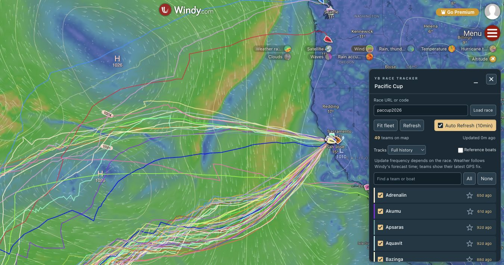

# YB Race Tracker for Windy

Experimental multi-race tracker derived from [GGR 2026 Windy plugin](https://github.com/ggrwindy/windyggr), with its Git history preserved. This repository develops race selection independently; the original repository and its published GGR-only plugin stay separate.

Built using AI and OpenAI Codex for implementation, testing, and documentation.



## Try it locally

Requires Node.js 22.18 or later.

```sh
npm ci
npm start
```

The bundle server listens only on `127.0.0.1:10000`. Open [Windy developer mode](https://www.windy.com/developer-mode), enter `http://localhost:10000/plugin.js`, press Tab, and choose **Install & open plugin**. Complete Windy's developer terms yourself if prompted. Keep the local server running while testing. Stop it with Ctrl+C.

The experimental plugin has its own identity, `windy-plugin-yb-tracker`, and route `/yb-race-tracker`. It is configured as private and has not been submitted to the gallery. The GGR-only plugin uses a different identity and preferences.

Enter a public YB race code or HTTPS race link and choose **Load race**. The input offers these tested examples:

| Race | Code | Capture coverage |
| --- | --- | --- |
| Golden Globe Race 2026 | `ggr2026` | Original fixture: 16 competitors and 4 reference entries |
| RORC Baltic Sea Race 2026 | `balticsearace2026` | 24 teams, 23 with fixes; 24,298 historical fixes |
| Pacific Cup | `paccup2026` | 49 teams; 39,981 historical fixes |

Titles come from race metadata. Favorites, visibility, track window, reference display, and automatic refresh are saved separately for each race. The last successfully loaded race is restored on reopening. A failed selection leaves the previous race on the map. Superseded requests are cancelled, and late results cannot replace the active race.

## Controls

- Star a team to move it to the top and emphasize its marker and track.
- Search teams, toggle visibility, or use All/None.
- Fit fleet frames selected competitors, excluding reference entries and retired teams.
- Choose full history, seven days, 24 hours, or tracks off.
- Show reference entries when the race identifies them with explicit reference, ghost, historical, or previous-competitor class labels.
- Click a team or marker for GPS time, coordinates, and average navigation details; click outside to dismiss.
- Automatic refresh defaults to every ten minutes. GPS reporting frequency depends on the race. Weather follows Windy's forecast time; teams show their latest GPS fixes.

## Compatibility and data

The browser makes two credential-free CORS GETs directly to `https://cf.yb.tl`: `JSON/<race>/RaceSetup` and `BIN/<race>/AllPositions3`. There is no backend, proxy, or database. Race input accepts official `yb.tl`/`cf.yb.tl` HTTPS links or race codes; requests always use the fixed data host.

This supports compatible public races, not every YB event. Protected, unavailable, differently encoded, or inaccessible endpoints can fail. Some public race endpoints returned HTTP 503 during compatibility testing. Those failures are surfaced without clearing the previous successful load. Update and archive availability are controlled by the source tracker.

Class labels are used conservatively for reference detection; unknown classes remain competitors. The plugin does not reproduce an official leaderboard, handicaps, race course, or forecast-time race playback. Team names and the secondary owner/boat text follow the source metadata.

When several fixes share the latest GPS timestamp, the first record in YB's newest-first wire order is used as the latest position. All historical records are preserved, including duplicate timestamps.

## Development and verification

```sh
npm run dev    # watch/rebuild; use Reload plugin in Windy after changes
npm run check  # Svelte and TypeScript diagnostics
npm run build # production bundles and manifest in dist/
npm test      # offline regression tests; build first
```

Live Windy browser testing also loaded Round the Island Race 2026 (`rti2026`, 47 teams with fixes), exercised returning to a race with its saved favorites, rejected an unrelated URL without clearing the fleet, and checked team popups and closing/reopening. Some races that returned HTTP 503 in command-line checks loaded successfully in Windy, so endpoint failures are not treated as proof that a race is incompatible.

The 17 tests cover the original GGR behavior, race-code/link validation, fixed-host requests, explicit reference classes, same-second fixes, cross-race preference isolation, switching, last-race restoration, failures, cancelled/stale requests, popups, and cleanup.

Fixtures under `tests/fixtures/` include captured public metadata and position binaries. The additional races include independently captured latest coordinates from [Baltic Simple view](https://yb.tl/Simple/balticsearace2026) and [Pacific Cup Simple view](https://yb.tl/Simple/paccup2026). All 72 available latest positions are compared against those independent values within the Simple view's coordinate rounding. Tests do not access the network.

`src/screenshot.jpg` shows the experimental interface. Production bundles include styles; generated files live in ignored `dist/`.

## Optional private publication

Publishing is separate from local testing. No publishing credential is copied from the original repository.

For a private test release, use a Windy Plugins API key from the intended Windy account, copy `.windy-publish.env.example` to `.windy-publish.env`, and fill in the key. Keep `WINDY_REPOSITORY=https://github.com/ggrwindy/windy-yb-tracker`. The file is ignored by Git and must never be committed.

Update both version fields, commit/push the source, create a matching GitHub release, then run:

```sh
npm run deploy:prepare  # validate and package without uploading
npm run deploy         # upload to Windy and verify hosted bundle bytes
```

The publisher requires `private: true`, a clean Git tree, matching versions, and a gallery screenshot. It packages only the three plugin files and screenshot with neutral archive ownership, embeds real repository/commit metadata, and sends the key only to Windy's official upload endpoint. Attach the resulting `dist/plugin.tar` to the matching GitHub release. This workflow never updates the original GGR plugin.
